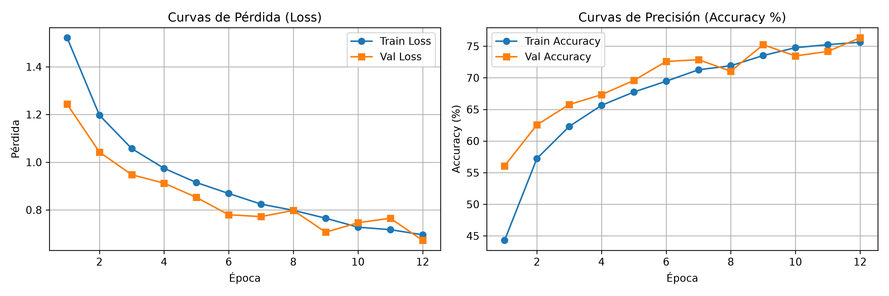
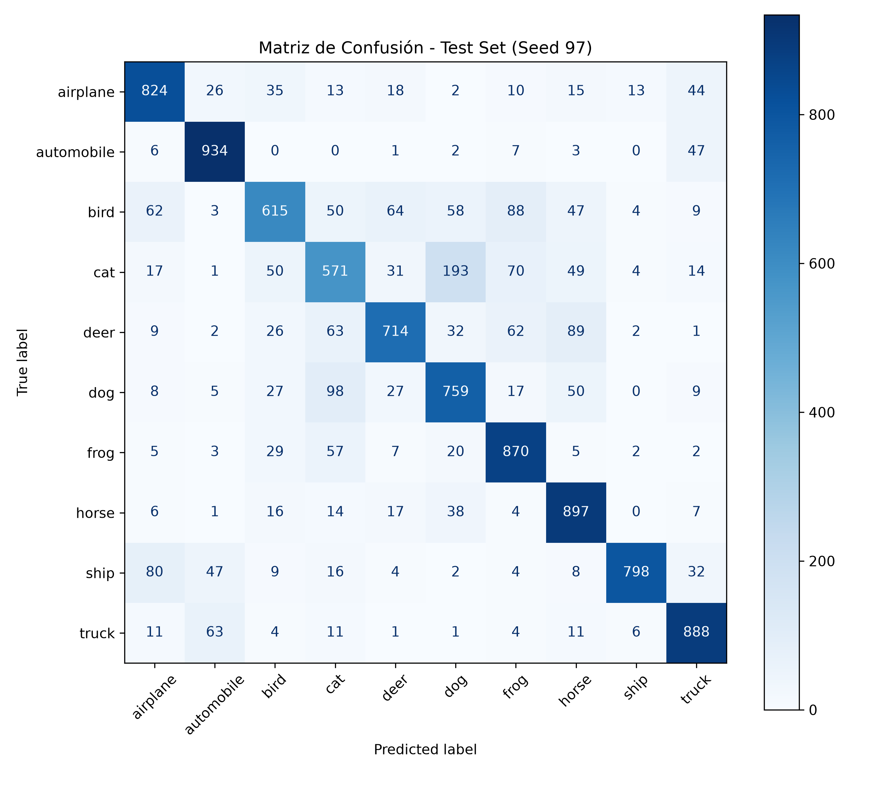

# Evaluación de la Segunda Unidad - Clasificación de Imágenes mediante CNN

**Estudiante:** Jhojan Abel Yana Ramos  
**Código / Semilla Individual:** 97  
**Dataset:** CIFAR-10 (60,000 imágenes RGB de 32x32 píxeles, 10 clases)

---

## Estructura del repositorio

```text
nombre_repositorio/
├── src/
│   ├── dataset.py      # Carga, transformaciones, partición y visualización (Pregunta 1)
│   ├── model.py        # Arquitectura CNN y validación de tensores (Pregunta 3)
│   └── train.py        # Entrenamiento, evaluación y gráficos (Pregunta 4)
├── notebooks/
│   └── experiment.ipynb
├── outputs/
│   ├── loss_accuracy.png
│   └── confusion_matrix.png
└── README.md
```

---

## 1. Justificación Teórica: CNN vs. MLP (Pregunta 2)

### Ineficiencia y colapso del Perceptrón Multicapa (MLP)

1. **Destrucción de la correlación espacial:** CIFAR-10 está formado por tensores cuatridimensionales `[B, 3, 32, 32]`. Un MLP obliga a aplanar cada muestra en un vector unidimensional de $32 \times 32 \times 3 = 3072$ variables. Esto destruye la estructura bidimensional de la imagen: la red pierde la noción de vecindad entre píxeles adyacentes (horizontales, verticales y diagonales) y trata cada píxel como una variable independiente.
2. **Explosión paramétrica y sobreajuste:** Conectar una entrada de 3072 elementos a una capa oculta estándar de 1024 neuronas requeriría:

   $$\text{Parámetros} = (3072 \times 1024) + 1024 = 3{,}146{,}752 \text{ pesos}$$

   Esta cantidad de parámetros en una sola capa encarece el cómputo y la memoria, y favorece el sobreajuste. Además, el MLP no es robusto ante pequeños desplazamientos del objeto en la imagen, porque cada posición tiene pesos propios.

### Solución mediante convoluciones (CNN)

* **Conexiones locales (Local Receptive Fields):** Cada neurona opera únicamente sobre una subregión pequeña ($3 \times 3$), preservando la coherencia espacial y detectando características locales (líneas, esquinas, texturas). Las capas profundas combinan estas características en patrones más complejos.
* **Compartición de pesos (Weight Sharing):** Un mismo kernel se desplaza sobre todo el mapa de características, reutilizando sus parámetros. El número de parámetros depende del tamaño del kernel y del número de filtros, no de la resolución de la imagen. Nuestra CNN completa tiene **620,810 parámetros entrenables**, una fracción de los 3.1 millones que requiere una sola capa oculta del MLP descrito arriba.
* **Equivariancia e invarianza a la traslación:** La convolución es equivariante a la traslación (si el objeto se desplaza, su mapa de activación se desplaza igual). La combinación con capas de submuestreo (`MaxPool2d`) aporta invarianza parcial, lo que permite reconocer un objeto con independencia de su posición exacta en la imagen.

---

## 2. Especificación de la Arquitectura (Preguntas 2 y 3)

| Bloque / Capa | Tipo de Operación | Tensor de Entrada | Configuración / Kernels | Tensor de Salida | Activación |
|---|---|---|---|---|---|
| **Bloque 1** | Conv2d + BatchNorm + MaxPool | `[B, 3, 32, 32]` | 32 filtros ($3\times3$, stride 1, pad 1) + Pool ($2\times2$) | `[B, 32, 16, 16]` | ReLU |
| **Bloque 2** | Conv2d + BatchNorm + MaxPool | `[B, 32, 16, 16]` | 64 filtros ($3\times3$, stride 1, pad 1) + Pool ($2\times2$) | `[B, 64, 8, 8]` | ReLU |
| **Bloque 3** | Conv2d + BatchNorm + MaxPool | `[B, 64, 8, 8]` | 128 filtros ($3\times3$, stride 1, pad 1) + Pool ($2\times2$) | `[B, 128, 4, 4]` | ReLU |
| **Aplanado** | Flatten | `[B, 128, 4, 4]` | $128 \times 4 \times 4$ | `[B, 2048]` | - |
| **Densa 1** | Linear + Dropout(0.3) | `[B, 2048]` | 256 neuronas | `[B, 256]` | ReLU |
| **Salida** | Linear | `[B, 256]` | 10 neuronas | `[B, 10]` | Lineal (logits) |

### Validación de tensores 4D (aserciones en `src/model.py`)

Para descartar un desajuste dimensional (*Shape Mismatch*), el forward pass se validó con un lote simulado. Salida en consola:

```text
--- Verificación de Flujo de Tensores 4D ---
Shape Entrada (4D): torch.Size([8, 3, 32, 32])
Post-Bloque 1:      torch.Size([8, 32, 16, 16])
Post-Bloque 2:      torch.Size([8, 64, 8, 8])
Post-Bloque 3:      torch.Size([8, 128, 4, 4])
Post-Flatten:       torch.Size([8, 2048])
Logits Salida:      torch.Size([8, 10])
Validación completada: todas las dimensiones son correctas.
```

---

## 3. Configuración Experimental (Preguntas 1 y 4)

* **Semilla global:** `SEED = 97` (`torch.manual_seed(97)` y `np.random.seed(97)`).
* **Partición estratificada:**
  * Entrenamiento: 42,500 imágenes (85% del conjunto de entrenamiento base).
  * Validación: 7,500 imágenes (15%).
  * Prueba: 10,000 imágenes independientes.
* **Transformaciones:**
  * Entrenamiento: `RandomCrop(32, padding=4)`, `RandomHorizontalFlip()`, `ToTensor()`, `Normalize(mean=[0.4914, 0.4822, 0.4465], std=[0.2470, 0.2435, 0.2616])`.
  * Validación y prueba: `ToTensor()` y `Normalize(...)` (sin aumento de datos).
* **Hiperparámetros:** 12 épocas, batch size 64, learning rate 0.001, optimizador `Adam`, función de pérdida `CrossEntropyLoss`.

---

## 4. Artefactos Gráficos y Curvas de Aprendizaje (Pregunta 4)

### Curvas de pérdida y precisión (`outputs/loss_accuracy.png`)



### Matriz de confusión (`outputs/confusion_matrix.png`)



---

## 5. Análisis Crítico de Métricas (Semilla 97)

### Métricas finales

| Conjunto | Pérdida (Loss) | Precisión (Accuracy) | Muestras |
|---|---|---|---|
| Entrenamiento (época 12) | 0.7011 | 75.76% | 42,500 |
| Validación (época 12) | 0.6789 | 76.12% | 7,500 |
| Prueba (independiente) | 0.6124 | 78.70% | 10,000 |

### Diagnóstico de ajuste (Underfitting / Overfitting)

* **Sin overfitting:** La brecha de precisión entre entrenamiento (75.76%) y validación (76.12%) es de apenas 0.36 puntos porcentuales, y en ningún momento la pérdida de validación se separa de forma sostenida por encima de la de entrenamiento. La precisión en prueba (78.70%) confirma que el modelo generaliza a datos no vistos.
* **Validación por encima de entrenamiento:** Durante el entrenamiento están activos `Dropout(0.3)` y el aumento de datos (`RandomCrop`, `RandomHorizontalFlip`), que hacen la tarea más difícil. En validación y prueba el modelo opera en modo `model.eval()` y sin aumento de datos, por lo que es normal que sus métricas igualen o superen a las de entrenamiento.
* **Ligero underfitting / falta de convergencia:** La pérdida pasa de ~1.5 a ~0.7 con una tendencia descendente, aunque con fluctuaciones en la validación (por ejemplo, un leve repunte hacia las épocas 10-11). Al llegar a la época 12 las curvas aún no se han estabilizado y la precisión de entrenamiento (~76%) es moderada, por lo que el modelo no ha convergido por completo. Es razonable esperar una mejora al entrenar más épocas, ajustando el learning rate o con una arquitectura de mayor capacidad.

### Análisis por clases (Recall en el conjunto de prueba)

$$\text{Accuracy global (test)} = \frac{7870}{10000} = \mathbf{78.70\%}$$

* **Clases mejor reconocidas:** `automobile` (93.4%), `horse` (89.7%), `truck` (88.8%), `frog` (87.0%) y `airplane` (82.4%). Los vehículos presentan formas rígidas y contextos distintivos que facilitan su separación.
* **Clases con mayor dificultad:**
  * `cat` (recall más bajo, 57.1%): 193 gatos fueron clasificados como `dog` (falsos negativos de `cat` y falsos positivos de `dog`). A su vez, 98 perros se confundieron con gatos. La similitud morfológica y de pelaje, sumada a la baja resolución de 32x32 píxeles, dificulta distinguir rasgos finos.
  * `bird` (61.5%): su mayor confusión es con `frog` (88 casos), seguida de `deer` (64), `airplane` (62) y `dog` (58), asociada a similitudes de fondo (vegetación, cielo) y de silueta.

---

## 6. Reproducción del experimento

```bash
# Validación de tensores (muestra los shapes intermedios)
python src/model.py

# Entrenamiento completo y generación de gráficos en outputs/
python src/train.py
```